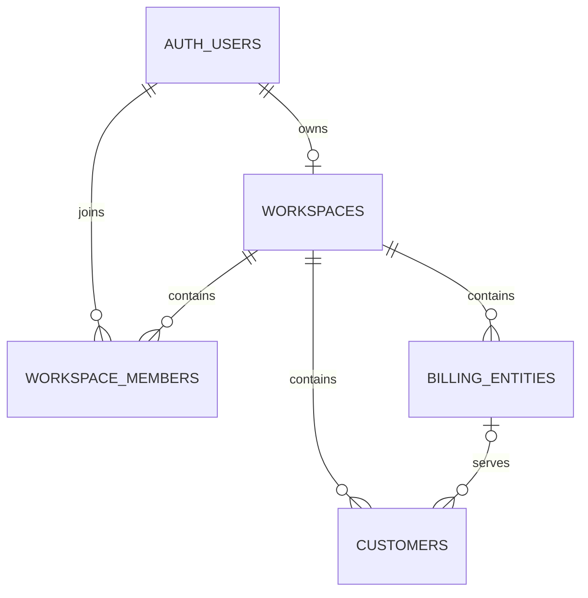

# Application Database Schema

> Historical baseline. The seven `20261114...` migrations have since been applied to the linked Supabase project and expand the application to 22 tables. See [the complete schema design](DATABASE_SCHEMA_PROPOSED.md) and [setup instructions](README.md). Migration SQL is the authoritative implemented definition.

As of 13 November 2026.

## Scope

The application uses Supabase PostgreSQL. This document consolidates the four repository migrations through `20261113000100_customer_contact_phone.sql`. It describes the schema defined in source control. Application of these migrations to a deployed database has not been verified.

There are four application tables in the `public` schema. `auth.users` and `storage.buckets` are Supabase-managed tables referenced by the migrations.

## Relationships

Each owner can have at most one workspace. Customers belong to a billing entity within the same workspace. The optional entity relationship in the diagram accounts for legacy customer records with a null `entity_id`. New inserts and updates must satisfy the entity requirement.

## Tables

### `public.workspaces`

| Column | PostgreSQL type | Nullable | Default | Constraints |
|---|---|---|---|---|
| `id` | `uuid` | No | `gen_random_uuid()` | Primary key |
| `owner_user_id` | `uuid` | No | None | Unique, references `auth.users(id)` |
| `name` | `text` | No | `'Billing Workspace'` | |
| `created_at` | `timestamptz` | No | `now()` | |
| `updated_at` | `timestamptz` | No | `now()` | |

The migrations define no automatic update trigger for this table's `updated_at` column.

### `public.workspace_members`

| Column | PostgreSQL type | Nullable | Default | Constraints |
|---|---|---|---|---|
| `workspace_id` | `uuid` | No | None | References `public.workspaces(id)` with `ON DELETE CASCADE` |
| `user_id` | `uuid` | No | None | References `auth.users(id)` |
| `role` | `text` | No | None | Must equal `'owner'` |
| `created_at` | `timestamptz` | No | `now()` | |

The primary key is `(workspace_id, user_id)`.

### `public.billing_entities`

| Column | PostgreSQL type | Nullable | Default | Constraints |
|---|---|---|---|---|
| `id` | `uuid` | No | `gen_random_uuid()` | Primary key |
| `workspace_id` | `uuid` | No | None | References `public.workspaces(id)` |
| `entity_code` | `text` | No | None | Matches `^[A-Z0-9_-]{1,24}$` |
| `legal_name` | `text` | No | None | Trimmed length between 1 and 200 |
| `display_name` | `text` | Yes | None | |
| `billing_address` | `jsonb` | No | `'{}'::jsonb` | |
| `email` | `text` | Yes | None | |
| `phone` | `text` | Yes | None | |
| `gst_registered` | `boolean` | No | `false` | |
| `gstin` | `text` | Yes | None | Required with trimmed length 15 when `gst_registered` is true |
| `pan` | `text` | Yes | None | |
| `state_code` | `text` | Yes | None | |
| `bank_details` | `jsonb` | No | `'{}'::jsonb` | |
| `upi_id` | `text` | Yes | None | |
| `payment_instructions` | `text` | Yes | None | |
| `invoice_prefix` | `text` | Yes | None | |
| `default_due_days` | `integer` | No | `30` | Between 0 and 365 |
| `financial_year_start_month` | `integer` | No | `4` | Between 1 and 12 |
| `is_active` | `boolean` | No | `true` | |
| `created_at` | `timestamptz` | No | `now()` | |
| `updated_at` | `timestamptz` | No | `now()` | Set automatically before updates |

Unique constraints apply to `(workspace_id, entity_code)` and `(workspace_id, id)`.

### `public.customers`

| Column | PostgreSQL type | Nullable | Default | Constraints |
|---|---|---|---|---|
| `id` | `uuid` | No | `gen_random_uuid()` | Primary key |
| `workspace_id` | `uuid` | No | None | References `public.workspaces(id)` |
| `entity_id` | `uuid` | Yes in column definition | None | Required by check constraint for new inserts and updates, composite foreign key described below |
| `legal_name` | `text` | No | None | Trimmed length between 1 and 200 |
| `display_name` | `text` | Yes | None | |
| `billing_address` | `jsonb` | No | `'{}'::jsonb` | |
| `shipping_address` | `jsonb` | Yes | None | |
| `contact_name` | `text` | Yes | None | |
| `contact_phone` | `text` | Yes | None | Added in the latest migration |
| `email` | `text` | Yes | None | |
| `phone` | `text` | Yes | None | |
| `gstin` | `text` | Yes | None | |
| `state_code` | `text` | Yes | None | |
| `country` | `text` | Yes | None | |
| `payment_terms_days` | `integer` | Yes | None | Between 0 and 365 when supplied |
| `notes` | `text` | Yes | None | |
| `is_active` | `boolean` | No | `true` | |
| `created_at` | `timestamptz` | No | `now()` | |
| `updated_at` | `timestamptz` | No | `now()` | Set automatically before updates |

#### Entity constraints

- `customers_entity_workspace_fk` references `public.billing_entities(workspace_id, id)` from `(workspace_id, entity_id)`. This ensures the customer and billing entity share a workspace.
- `customers_require_entity` enforces `CHECK (entity_id IS NOT NULL) NOT VALID`. Existing records were not validated when this constraint was added. New inserts and updates must satisfy it.
- Legacy customers without an entity are hidden from authenticated clients by the customer access policy.

## Indexes

| Index | Table | Columns |
|---|---|---|
| `customers_workspace_name_idx` | `public.customers` | `(workspace_id, legal_name, id)` |
| `customers_entity_name_idx` | `public.customers` | `(entity_id, legal_name, id)` |

PostgreSQL also creates indexes for the primary keys and unique constraints listed above.

## Functions and Triggers

### `public.initialize_workspace()`

- Returns a table containing `id uuid` and `name text`.
- Runs as `SECURITY DEFINER` with an empty `search_path`.
- Requires an authenticated, registered user and rejects anonymous accounts.
- Creates the user's workspace if it does not exist.
- Creates the corresponding membership with role `owner` if it does not exist.
- Returns the workspace ID and name.
- Grants execution to `authenticated`. Execution is revoked from `public` and `anon`.

### `public.update_directory_timestamp()`

A trigger function that sets `NEW.updated_at = now()` and returns the updated row. It uses an empty `search_path`.

| Trigger | Table | Execution |
|---|---|---|
| `billing_entities_updated` | `public.billing_entities` | Before each row update |
| `customers_updated` | `public.customers` | Before each row update |

## Access Control

Row-level security is enabled on all four application tables. The migrations revoke all table privileges from `public`, `anon`, and `authenticated`, then grant the authenticated privileges below.

### Policies

| Table | Policy | Operations | Access condition |
|---|---|---|---|
| `workspaces` | `Owners can read their workspace` | Select | `owner_user_id = auth.uid()` |
| `workspace_members` | `Owners can read their membership` | Select | `user_id = auth.uid()` and the workspace is visible to the user |
| `billing_entities` | `billing_entities_owner` | All, subject to privileges | The workspace belongs to the authenticated user |
| `customers` | `customers_entity_owner` | All, subject to privileges | An active billing entity exists with matching entity and workspace IDs and is visible through the billing entity policy |

The billing entity and customer policies apply matching conditions to both existing rows (`USING`) and proposed rows (`WITH CHECK`).

### Authenticated privileges

| Table | Select | Insert | Update | Delete |
|---|---|---|---|---|
| `workspaces` | Granted | No grant | No grant | No grant |
| `workspace_members` | Granted | No grant | No grant | No grant |
| `billing_entities` | Granted | Explicit columns | Explicit columns | No grant |
| `customers` | Granted | Explicit columns | Explicit columns | No grant |

For `billing_entities`, insert is granted on `workspace_id` and every business column from `entity_code` through `is_active`. Update is granted on the same business columns, excluding `workspace_id`. The generated ID and timestamp columns have no authenticated write grant.

For `customers`, insert is granted on `workspace_id`, `entity_id`, and every business column from `legal_name` through `is_active`, including `contact_phone`. Update is granted on those business columns, excluding `workspace_id` and `entity_id`. The generated ID and timestamp columns have no authenticated write grant.

## Storage Buckets

| Bucket ID | Name | Public |
|---|---|---|
| `billing-assets` | `billing-assets` | No |
| `invoice-pdfs` | `invoice-pdfs` | No |

The migrations create these records in `storage.buckets`. They define no storage object access policies.

## Current Coverage

The repository migrations cover workspaces, owner memberships, billing entities, and customers. Invoice, invoice-item, payment, and challan tables are not defined in these migrations. JSONB address and bank-detail fields have no database constraints on their internal structure.

## Source Migrations

Apply and interpret these migrations in chronological order.

| Migration | Changes |
|---|---|
| [20261106000100_workspace_foundation.sql](supabase/migrations/20261106000100_workspace_foundation.sql) | Workspaces, memberships, workspace initialization, access policies, and private storage buckets |
| [20261106000200_billing_directory.sql](supabase/migrations/20261106000200_billing_directory.sql) | Billing entities, customers, directory timestamps, indexes, privileges, and policies |
| [20261107000100_entity_customer_scope.sql](supabase/migrations/20261107000100_entity_customer_scope.sql) | Customer entity assignment, workspace consistency constraint, entity index, and replacement customer policy |
| [20261113000100_customer_contact_phone.sql](supabase/migrations/20261113000100_customer_contact_phone.sql) | Customer contact phone and its insert/update privileges |
