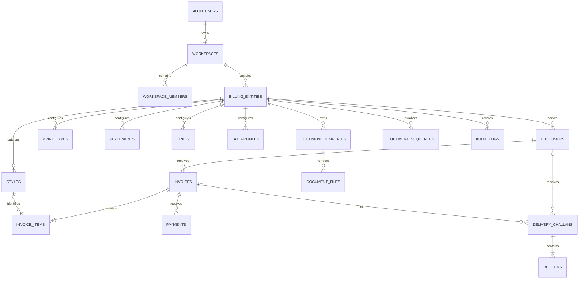

# Thogai Proposed Database Schema

Prepared on 13 November 2026.

Implementation status updated after integration. The seven migrations from `20261114000100` through `20261114000700` implement the 22-table structure and are applied to the linked Supabase project. Billing, style resolution, receipts, challans, templates, private files, and report APIs are connected. PDF jobs run on download requests. Report jobs materialize data in `report_exports.data_snapshot`. The template editor currently supports presets, accent, logo, and signature. Advanced layout editing and browser-data import tooling remain additional application work. See the migration SQL for exact types, permissions, and supported operations.

## 1. Purpose and status

This is the target PostgreSQL/Supabase schema for the full application described in [THOGAI_PROJECT_SCOPE.md](THOGAI_PROJECT_SCOPE.md), plus automatic style creation during billing. It is a design specification for implementation. The existing database is documented separately in [DATABASE_SCHEMA.md](DATABASE_SCHEMA.md).

The design covers authentication references, workspace ownership, multiple billing entities, entity-specific customers and styles, printing options, invoices, delivery challans, receipts, templates, permanent numbering, PDFs, reports, audit history, and retry handling.

### Design decisions

- Retain the existing `billing_entities` table name and existing directory columns for compatibility.
- Customers and styles belong to one entity. The same style number in different entities represents separate records. Within an entity, a style number is shared across customers. Customer-specific styles would require a different uniqueness scope.
- Treat the style number entered by the operator as the business style code. Generate an internal UUID for a new style. Do not substitute an unrelated generated business number for the operator's input.
- Keep style entry optional for generic service lines. Every nonblank style entry must resolve to a stored style before the line is saved.
- Support INR initially. Store currency on financial documents and receipts and require matching currencies.
- Each payment belongs to exactly one invoice, matching the final simplified scope. An invoice supports multiple receipts and complete receipt reversals.
- Preserve the owner-only access model. Separate operator accounts and their permissions require a future access-model extension. Each recorded user action identifies the authenticated actor.

## 2. Relationship overview



The minimum one-item relationships are enforced at issuance. A draft may temporarily contain no items. Workspace-level audit events may have a null entity ID.

## 3. Shared conventions and integrity

| Convention | Definition |
|---|---|
| Primary identifiers | `uuid PRIMARY KEY DEFAULT gen_random_uuid()` unless a composite key is specified |
| Business dates | `date`, interpreted using workspace timezone, default `Asia/Kolkata` |
| Event timestamps | `timestamptz`, server-generated |
| Money | `numeric(18,2)` |
| Quantity | `numeric(12,3)` |
| Unit rate | `numeric(18,4)` |
| Percentages | `numeric(7,4)`, range 0 through 100 |
| Mutable records | `created_at`, `updated_at`, and `version bigint NOT NULL DEFAULT 1` |
| Actors | `created_by`, `updated_by` reference `auth.users(id)` where applicable |
| Optimistic edits | Update with expected `version`, increment version atomically, reject stale edits |
| Archiving | `is_active boolean NOT NULL DEFAULT true`, optional `archived_at` |
| Deletion | Restrict deletion of referenced business records and all issued documents |

All entity-owned tables carry required `workspace_id` and `entity_id`. `billing_entities` uses its own `id` as entity identity and has `UNIQUE(workspace_id, id)`. Each entity-owned table references that pair.

Parent records expose `UNIQUE(workspace_id, entity_id, id)`. Child records reference the full tuple, so a valid foreign key cannot attach data to another entity or workspace. Invoice-to-customer and challan-to-customer references follow this rule. Optional references must have explicit null handling.

Use `NOT NULL`, foreign keys, unique constraints, and checks for row-level invariants. Use database transaction functions and defensive triggers for cross-row invariants such as receipt sums and document lifecycle rules. A foreign key alone cannot enforce these rules.

All numeric inputs must reject PostgreSQL numeric special values (`NaN` and infinities) in addition to satisfying the stated ranges. JSON settings must be objects validated against an application schema version. Addresses retain their existing JSONB representation.

## 4. Workspace and company tables

### `workspaces` and `workspace_members`

Retain existing columns and constraints. Add `workspaces.timezone text NOT NULL DEFAULT 'Asia/Kolkata'` and `default_currency text NOT NULL DEFAULT 'INR'`. Validate timezone against PostgreSQL timezone names in the controlled settings operation. Enable the shared update timestamp behavior on workspaces.

Membership remains `(workspace_id, user_id)` with role restricted to `owner`. The workspace owner is the authorization source of truth. Membership creation stays inside `initialize_workspace()`.

### `billing_entities`

Retain all current identity, contact, GST, bank, UPI, invoice prefix, due-day, fiscal-year, activity, and timestamp fields.

| Added column | Type | Rules |
|---|---|---|
| `dc_prefix` | text | Required before issuing a challan |
| `numbering_mode` | text | Required, `financial_year` or `continuous`, default `financial_year` |
| `currency` | text | Required, default `INR`, V1 check equals `INR` |
| `default_tax_profile_id` | uuid | Optional, references a tax profile in this entity |
| `default_invoice_template_id` | uuid | Optional, references this entity's published invoice template |
| `default_dc_template_id` | uuid | Optional, references this entity's published challan template |
| `logo_path` | text | Optional private storage object path |
| `signature_path` | text | Optional private storage object path |
| `default_terms` | text | Optional |
| `rounding_increment` | numeric(18,2) | Required, default `0`, allowed `0` (disabled), `0.01`, or `1.00` |
| `archived_at` | timestamptz | Optional, consistent with `is_active` |
| `version`, `created_by`, `updated_by` | Shared types | Edit tracking |

Controlled settings functions validate template document types and asset ownership. Archiving blocks new drafts, issuance, and new styles, while allowing historical reads, receipt recording, reversals, and controlled cancellation of existing invoices. Referenced assets must remain retained for issued document reproduction.

Acquire a shared entity lock in create/issue/style operations and an exclusive row lock when changing activity or numbering settings. Recheck activity after locking. A settings change cannot race with issuance into an inconsistent numbering period. Once a numbering period has issued records, changes to financial-year start or numbering mode require a controlled transition that preserves existing period boundaries and all assigned numbers.

### `customers`

Retain existing fields, including `contact_phone`. Backfill legacy null `entity_id` values through explicit administrator assignment, validate `customers_require_entity`, then set `entity_id NOT NULL`. Do not guess legacy ownership.

Add `archived_at`, `version`, `created_by`, and `updated_by`. Expose `UNIQUE(workspace_id, entity_id, id)` for document references. Warn about similar names or matching GSTINs within the entity without treating either as universally unique.

Archived customers remain available for historical documents and collections. New invoices and challans require an active customer.

## 5. Styles and configurable printing options

### `styles`

| Column | Type | Rules |
|---|---|---|
| `id` | uuid | Primary key |
| `workspace_id`, `entity_id` | uuid | Required, entity foreign key |
| `style_number` | text | Required, trimmed length 1–100, preserves first saved spelling |
| `normalized_style_number` | text | Required generated value, `upper(btrim(style_number))` |
| `name` | text | Optional readable name |
| `description` | text | Optional reusable particulars |
| `default_print_type_id` | uuid | Optional, same-entity print type |
| `default_placement_id` | uuid | Optional, same-entity placement |
| `default_unit_id` | uuid | Optional, same-entity unit |
| `is_active` | boolean | Required, default true |
| `archived_at` | timestamptz | Optional |
| `created_at`, `updated_at`, `version`, `created_by`, `updated_by` | Shared types | Required where applicable |

Enforce `UNIQUE(workspace_id, entity_id, normalized_style_number)` and `UNIQUE(workspace_id, entity_id, id)`. Use a deterministic collation for the normalized key. Case and outer spaces are ignored. Preserve internal spaces, punctuation, and leading zeros. Thus ` st-001 ` and `ST-001` match, while `ST001` and `ST-001` remain distinct. Keep the same normalization contract for imports, lookup, creation, and search.

Style defaults are suggestions for new lines. They never overwrite a line the operator has edited. Do not store the last billed rate as a global style rate because customer prices may differ. Actual rates belong to invoice items.

An archived matching style produces an explicit archived-style result. The operator can restore it through a separate audited action. Do not create a duplicate or automatically reactivate it. Style numbers become immutable once referenced by an issued document. A corrected identity requires a new style record.

### Lookup tables

`print_types`, `placements`, and `units` each contain `id`, `workspace_id`, `entity_id`, `code`, `label`, `sort_order`, `is_active`, timestamps, version, and actor fields.

Each has `UNIQUE(workspace_id, entity_id, code)` and `UNIQUE(workspace_id, entity_id, id)`. Codes are trimmed uppercase identifiers. Referenced options may be archived but cannot be deleted.

Seed each entity with its own print methods (DTF, Sublimation, Heat Transfer, Puff, Plastisol, HD, Screen Printing, Other), placements (Front, Back, Left Chest, Right Chest, Sleeve, Neck, Other), and units (`PCS`, `BUNDLE`, `BOX`). An optional free-text placement detail on the invoice item supports custom descriptions.

### `tax_profiles`

Columns are `id`, `workspace_id`, `entity_id`, `name`, `tax_mode`, `cgst_rate`, `sgst_rate`, `igst_rate`, `other_tax_rate`, `is_active`, timestamps, version, and actors. Rates default to zero and each must be between 0 and 100. Modes are `none`, `intra_state`, `inter_state`, and `other`.

Require zero rates for `none`, only CGST/SGST for `intra_state`, only IGST for `inter_state`, and only other tax for `other`. Require total rate at most 100. Changes affect future selections only. Persist resolved rates on document lines. This stores tax calculation configuration, with statutory applicability determined separately during implementation.

## 6. Automatic style resolution during billing

### Entry and save behavior

1. The operator selects the company and customer, then enters a style number on a bill line.
2. Autocomplete searches only that company's active styles. Typing and search are read-only.
3. On committing the field (blur, Enter, or selecting an option), submit the complete nonblank value to `POST /api/v1/entities/:entityId/styles/resolve`.
4. The server verifies workspace ownership and entity activity, validates the input, and normalizes it in PostgreSQL.
5. If the normalized style exists, return its ID, saved number, and defaults. Otherwise insert it and return the new record.
6. Store the returned `style_id` on the draft line. Display the saved number. Keep unsaved text separate from the last resolved ID so changing text cannot retain the wrong style reference.
7. Saving the draft resolves all nonblank style inputs again within the same database transaction as the item writes. This covers fast submission, network retries, imports, and callers bypassing field resolution.
8. An unresolved or archived style blocks saving that line. A blank optional style stores both style ID and style snapshot as null.

Associate every field request with its input value and entity ID. Ignore a late response if either has changed. On database save, validate a supplied style ID against the submitted normalized number and selected entity, resolving again or rejecting a mismatch. Never trust a stale client ID. Duplicate-as-draft validates current active references and clears archived suggestions for explicit operator resolution.

Creation after field commit may leave unused styles if a draft is abandoned. Keep these reusable records, with explicit archive available. Do not create a row per keystroke. A preview-only page must not create styles.

### Database operation contract

Implement `resolve_style(entity_id uuid, style_number text)` as a controlled database function returning the style row. Derive `workspace_id` and actor from the authenticated request. Reject empty, oversized, or control-character input. Never accept a client-supplied workspace or creator as authoritative.

Use this insert pattern inside the function after authorization, followed by a separate select statement under PostgreSQL `READ COMMITTED` isolation.

```sql
INSERT INTO public.styles (
  workspace_id, entity_id, style_number, created_by, updated_by
)
VALUES (
  authorized_workspace_id, requested_entity_id,
  btrim(requested_style_number), auth.uid(), auth.uid()
)
ON CONFLICT (workspace_id, entity_id, normalized_style_number)
DO NOTHING;

SELECT *
FROM public.styles
WHERE workspace_id = authorized_workspace_id
  AND entity_id = requested_entity_id
  AND normalized_style_number = upper(btrim(requested_style_number))
FOR SHARE;
```

This is an implementation pattern with function variables, not standalone executable SQL. A generated normalized column and its unique constraint must exist first. Keep insert and select as separate statements so a concurrent conflicting insert becomes visible to the subsequent read. The shared row lock prevents archival during line attachment. All style archive/update operations must honor the corresponding row locks. Hard deletion of style records is denied.

At higher transaction isolation levels, retry the entire transaction on serialization failure. The uniqueness constraint is the final duplicate safeguard. Recheck `is_active` after fetching and return a domain error if archived. A conflict must not overwrite descriptions, defaults, spelling, or audit timestamps.

If implemented with `SECURITY DEFINER`, set `search_path = ''`, fully qualify relations, explicitly validate `auth.uid()` ownership, revoke execution from `PUBLIC` and `anon`, and grant only the intended authenticated execution. Return the resolved record directly instead of relying on RLS-hidden fallback reads.

### Examples

| Existing record in selected entity | Entered value | Result |
|---|---|---|
| `ST-100` | `st-100` | Reuse existing style ID |
| None | `ST-101` | Insert `ST-101`, generate UUID, attach it to the line |
| None, two concurrent requests | `ST-102` | One style row, both callers receive the same ID |
| `ST-100` in another entity only | `ST-100` | Create a separate style in the current entity |
| Archived `ST-103` | `ST-103` | Require an explicit restore action |
| None | Blank | Leave optional style reference empty |

## 7. Templates and numbering

### `document_templates`

Columns are `id`, `workspace_id`, `entity_id`, `document_type` (`invoice` or `delivery_challan`), `name`, `version_number integer`, `status` (`draft` or `published`), `settings_schema_version integer`, `settings_json jsonb`, `renderer_version text`, `published_at`, timestamps, and actor fields.

Use `UNIQUE(workspace_id, entity_id, document_type, name, version_number)` and `UNIQUE(workspace_id, entity_id, id)`. Configuration contains preset, layout, columns, colors, fonts, footer, terms, and asset references. Published versions are immutable. Create a new version to change them. Entity default pointers select published templates of the matching type. Preserve referenced renderer versions, fonts, and assets for reproduction.

### `document_sequences`

| Column | Type | Rules |
|---|---|---|
| `workspace_id`, `entity_id` | uuid | Required entity reference |
| `document_type` | text | `invoice` or `delivery_challan` |
| `period_key` | text | Financial-year identifier or `CONTINUOUS` |
| `period_start`, `period_end` | date | Required for fiscal periods, null for continuous numbering |
| `next_number` | bigint | Required, positive, default 1 |
| `updated_at` | timestamptz | Required |

Primary key is `(workspace_id, entity_id, document_type, period_key)`. Compute fiscal boundaries using entity settings in the issue transaction. Freeze period boundaries and prefix in the issued document. Setting changes must not reset existing counters.

Create the counter row with conflict handling, lock it, allocate/increment, and issue the document in one transaction. Deny direct counter changes. Enforce unique `(workspace_id, entity_id, document_number)` on each document table as well as unique `(workspace_id, entity_id, period_key, sequence_number)` for numbered documents. Prefix changes cannot reuse an earlier full number. Successful issuance permanently reserves its number, including after cancellation. A transaction rolled back before issuance creates no issued record.

## 8. Billing tables

### `invoices`

| Column group | Fields and rules |
|---|---|
| Identity | `id`, required `workspace_id`, `entity_id`, `customer_id`, same-entity customer FK |
| State | `status text NOT NULL DEFAULT 'draft'`, allowed `draft`, `issued`, `cancelled` |
| Number | Nullable `document_number text`, `period_key text`, `sequence_number bigint`, `number_prefix_snapshot text` until issuance |
| Numbering snapshot | `numbering_mode_snapshot text`, `period_start_snapshot date`, `period_end_snapshot date`, frozen at issuance, boundaries null only for continuous numbering |
| Dates | `invoice_date date NOT NULL`, `due_date date NOT NULL`, `issued_at timestamptz`, `issued_by uuid`, `due_date >= invoice_date` |
| References | `reference_number text`, `replacement_for_invoice_id uuid`, same-entity FK, no self-reference |
| Currency | `currency text NOT NULL DEFAULT 'INR'`, V1 restricted to INR |
| Totals | Required `subtotal`, `line_adjustment_total`, `line_discount_total`, `invoice_discount_total`, `taxable_total`, `cgst_total`, `sgst_total`, `igst_total`, `other_tax_total`, `tax_total`, `round_off`, `grand_total`, all money types, defaults zero |
| Content | `notes text`, `terms text`, `internal_memo text`, `shipping_details jsonb` |
| Calculation policy | `calculation_version text`, `rounding_increment_snapshot numeric(18,2)`, required on issue and preserved for regeneration |
| Tax context | `place_of_supply_state_code text`, `tax_treatment text`, required when the selected calculation profile needs them |
| Historical rendering | `seller_snapshot jsonb`, `customer_snapshot jsonb`, `payment_details_snapshot jsonb`, `template_id uuid`, `template_snapshot jsonb`, `snapshot_schema_version integer`, `renderer_version text` |
| Cancellation | `cancelled_at timestamptz`, `cancelled_by uuid`, `cancel_reason text` |
| Edit tracking | Shared timestamps, version, actor fields |

Enforce nonnegative totals except signed `line_adjustment_total` and `round_off`. Constrain round-off using the saved rounding policy and each adjustment using the item rules. Require number, issue metadata, snapshots, template, and at least one valid item on issue. Drafts have no issued or cancellation metadata. Cancelled records retain all issue fields and require nonblank reason, actor, and timestamp. Cancellation timestamp cannot precede issuance.

An invoice is mutable only while draft. After issue, freeze scope, customer, dates, number, items, totals, and snapshots. Permit only controlled cancellation metadata updates. Deleting a draft may cascade to its items through a guarded deletion function. Reject deletion of issued/cancelled invoices at the database level.

`replacement_for_invoice_id` must target a cancelled invoice for the same entity and customer. Resolve replacements through the controlled issue operation and reject cycles.

### `invoice_items`

| Column | Type / rules |
|---|---|
| `id`, `workspace_id`, `entity_id`, `invoice_id` | UUIDs, scoped invoice FK |
| `sort_order` | Positive integer, unique within invoice |
| `style_id` | Optional scoped style FK |
| `style_number_snapshot` | Text, required when style ID is present |
| `print_type_id`, `placement_id`, `unit_id` | Optional same-entity lookup references, unit required at issuance |
| `print_type_snapshot`, `placement_snapshot`, `unit_snapshot` | Text labels frozen at issuance |
| `placement_detail` | Optional text |
| `particulars` | Required nonblank text |
| `hsn_sac_code` | Optional text |
| `quantity` | Quantity type, greater than zero |
| `unit_rate` | Rate type, nonnegative |
| `gross_amount` | Money, computed by backend |
| `line_discount_amount` | Money, nonnegative and no greater than adjusted gross |
| `line_adjustment_amount` | Money, signed, default zero, applied before discounts and taxes |
| `line_adjustment_reason` | Text, required when line adjustment is nonzero |
| `invoice_discount_share` | Money, allocated header discount, nonnegative |
| `taxable_amount` | Money, nonnegative |
| `tax_profile_id`, `tax_mode_snapshot` | Optional scoped tax-profile UUID and required resolved mode at issuance |
| `cgst_rate`, `sgst_rate`, `igst_rate`, `other_tax_rate` | Percentage types, frozen resolved rates |
| `cgst_amount`, `sgst_amount`, `igst_amount`, `other_tax_amount` | Money, nonnegative |
| `tax_amount`, `line_total` | Money, computed |
| `created_at`, `updated_at` | Timestamps |

Guard all item insert/update/delete operations by locking the parent and requiring draft status. This lock is also taken by issuance, preventing concurrent line edits from escaping the freeze. Enforce style ID/snapshot nullability together. Preserve snapshots after style or lookup archival.

### Financial calculation contract

1. Prices are tax-exclusive. Calculate `gross_amount = round(quantity * unit_rate, 2)` for each line. Add any explicit `line_adjustment_amount` and require the adjusted gross to remain nonnegative. Snapshot the adjustment and reason. Store `invoices.line_adjustment_total` as the sum of line adjustments.
2. Subtract each line's fixed discount from its adjusted gross. Apply the fixed invoice discount proportionally across remaining positive line bases in integer paise. Use largest-remainder allocation with `sort_order` as the tie-breaker so shares sum exactly to the header discount.
3. Reject discounts exceeding the available base. A zero base permits only zero invoice discount.
4. `taxable_amount = gross_amount + line_adjustment_amount - line_discount_amount - invoice_discount_share`.
5. Round each applicable tax component per line to two decimals. Validate mutually compatible tax modes. Sum components for `tax_amount`, then add taxable amount for `line_total`.
6. Header totals equal the corresponding line sums. `subtotal` is the sum of unadjusted gross amounts. `taxable_total = subtotal + line_adjustment_total - line_discount_total - invoice_discount_total`. `grand_total = taxable_total + tax_total + round_off`. Default round-off is zero. If enabled, round the pre-round-off total to the nearest snapshotted increment, using half-up for nonnegative totals. Store the difference as `round_off` and require its absolute value to be at most half the increment. Persist the calculation version and increment on the invoice.
7. Require nonnegative grand total. Treat a zero-value issued invoice as paid with zero outstanding and disallow positive receipts.

Recompute and verify these values inside the controlled database save/issue transaction. Reject client totals that disagree. Report print-type billing from allocated line taxable/tax amounts, with any header round-off reported separately to reconcile the invoice total.

## 9. Receipts

### `payments`

Columns are `id`, `workspace_id`, `entity_id`, `invoice_id`, `payment_date date`, `amount numeric(18,2) CHECK (amount > 0)`, `currency text`, `method text`, `reference_number text`, `notes text`, `status text` (`posted` or `reversed`), `posted_at timestamptz`, `posted_by uuid`, `reversed_at timestamptz`, `reversed_by uuid`, and `reversal_reason text`.

Use a scoped invoice FK. Customer is derived from the immutable invoice. Allowed methods are `bank_transfer`, `upi`, `cash`, `cheque`, and `other`. Posting date cannot precede the invoice date. Reversal requires reason and actor, with a timestamp at or after posting. Preserve original receipt fields permanently.

`record_payment()` locks the parent invoice, requires issued/non-cancelled state and matching currency, sums posted receipts, and rejects amounts above remaining balance. All receipt posts, reversals, invoice cancellation, and relevant imports acquire the same invoice row lock. Deny direct payment mutation.

`reverse_payment()` changes a posted payment to reversed once and appends an audit event in the same transaction. Corrections reverse the old receipt and post a new receipt. A reversed receipt cannot be restored or deleted. Invoice cancellation requires no remaining posted receipts. Resolve payment corrections before cancellation.

Payment state and overdue are derived, with no writable status column on invoices.

```text
received = sum(posted payment amounts)
outstanding = grand_total - received
paid = outstanding equals zero
partially_paid = received greater than zero and outstanding greater than zero
unpaid = received equals zero and outstanding greater than zero
overdue = invoice is issued and due_date is before reporting_date
          and outstanding is greater than zero
```

## 10. Delivery challans

### `delivery_challans`

Columns are `id`, `workspace_id`, `entity_id`, `customer_id`, `status` (`draft`, `issued`, `cancelled`), `document_number`, `period_key`, `sequence_number`, `number_prefix_snapshot`, `dc_date date`, `related_invoice_id uuid`, `from_address jsonb`, `to_address jsonb`, `sender_snapshot jsonb`, `recipient_snapshot jsonb`, `template_id`, `template_snapshot`, `snapshot_schema_version`, `renderer_version`, `notes`, `issued_at`, `issued_by`, cancellation reason/actor/timestamp, and shared edit tracking.

Add `recipient_name text`, `numbering_mode_snapshot`, `period_start_snapshot`, and `period_end_snapshot` using the invoice numbering rules. `customer_id` is nullable for standalone free-text recipients supported by the current challan form. Require a nonblank recipient name and complete from/to addresses at issuance. Snapshot those entered details independently of the customer master. When a customer is selected, prefill its name/address and permit explicit delivery-address overrides.

Require same-entity customer, template, and optional invoice references. Additionally enforce `(workspace_id, entity_id, customer_id, related_invoice_id)` against a corresponding unique key on invoices, so the linked invoice has the same customer. Add a check requiring `customer_id IS NOT NULL` whenever `related_invoice_id IS NOT NULL`, avoiding a nullable composite-FK bypass. Null invoice ID is allowed. Selecting an invoice fills its customer ID. New links require a non-cancelled issued invoice. Multiple challans may link to one invoice. Customer-based reports group standalone recipients separately instead of guessing a customer match from their names.

Issuance follows invoice locking, snapshot, numbering, and immutability rules using an independent challan sequence. It requires at least one valid item. Preserve entered from/to address overrides in issued snapshots. A later cancellation of a related invoice preserves the historical link and is visible in the challan view.

### `dc_items`

Columns are `id`, `workspace_id`, `entity_id`, `dc_id`, `sort_order`, `particulars text`, `quantity numeric(12,3)`, `unit_id uuid`, `unit_snapshot text`, `remarks text`, and timestamps.

Require nonblank particulars, positive quantity, scoped parent/unit references, and unique `(dc_id, sort_order)`. Lock the parent and permit item changes only while draft. Delivery confirmation fields are stored separately below so acknowledging delivery does not modify the issued document.

### `delivery_acknowledgements`

Columns are `id`, `workspace_id`, `entity_id`, `dc_id`, `received_by text`, `received_at timestamptz`, `signature_path text`, `notes text`, `recorded_at`, and `recorded_by`.

At most one acknowledgement per challan. Require an issued challan and at least a receiver name or signature. Retain acknowledgements as audited records. Cancellation preserves them. This supports the scope's optional received-by/signature fields without introducing dispatch tracking.

## 11. Files, background work, and audit

### `document_files`

Columns are `id`, `workspace_id`, `entity_id`, nullable `invoice_id`, nullable `dc_id`, `template_id`, `document_revision integer`, `variant` (`original` or `cancelled`), `status` (`pending`, `processing`, `ready`, `failed`), `bucket_id`, `object_path`, `sha256`, `mime_type`, `byte_size`, `attempt_count`, `last_error`, `lease_expires_at`, `claim_token uuid`, `next_attempt_at`, `generated_at`, and timestamps.

Require exactly one invoice/DC parent via a check and scoped foreign keys. Use separate partial unique indexes on each parent plus `(document_revision, variant)` to deduplicate rendering. Require path, hash, positive size, and generation timestamp for ready files. Cancelled versions are separate artifacts, preserving the original.

Create pending work inside issuance/cancellation transactions. Workers claim with `FOR UPDATE SKIP LOCKED`, a lease, and a fresh claim token. Completion must match the current token so an expired worker cannot overwrite a retry. Render immutable snapshots, upload to a unique versioned path, then mark ready. A failed upload never creates another invoice or document number. Clean up unreferenced failed uploads through a controlled retention process.

### `report_exports`

Columns are `id`, `workspace_id`, `requested_by`, `report_type`, `entity_ids uuid[]`, `filters_json jsonb`, `as_of_date date`, `generated_at`, `format` (`pdf` or `csv`), `status`, storage path/hash/size, `attempt_count`, lease/claim/retry fields, `last_error`, `expires_at`, and timestamps.

Validate every selected entity against the workspace at request and execution time. Filters capture date basis, selected entities, customer, timezone, and metric definitions. Regeneration creates a new export record. Private download authorization rechecks workspace access.

Define the queue fields explicitly as `status text` (`pending`, `processing`, `ready`, `failed`, `expired`), `bucket_id text`, `object_path text`, `sha256 text`, `byte_size bigint`, `attempt_count integer DEFAULT 0`, `lease_expires_at timestamptz`, `claim_token uuid`, `next_attempt_at timestamptz`, and `last_error text`. Also store required `recorded_through timestamptz`, `business_timezone text`, `report_definition_version text`, `title_snapshot text`, and `entity_names_snapshot jsonb`. Require a nonempty duplicate-free entity array, with a trigger validating every array member against `workspace_id`. Ready exports require file metadata and generation timestamp. Expired exports retain request/audit metadata after file cleanup. Claim and complete jobs using the same lease-token discipline as document files.

Each export reads source records from a single consistent database snapshot. Retries after source changes produce a new export request with new cutoffs, or reuse already materialized report rows retained in private job input storage. Do not silently regenerate different content under an existing ready file's identity.

### `audit_logs`

Columns are `id`, `workspace_id`, optional `entity_id`, optional `actor_user_id`, `actor_type` (`user` or `system`), `action`, `resource_type`, `resource_id`, `request_id`, `before_json`, `after_json`, `metadata_json`, and `occurred_at`.

Use append-only writes from trusted transaction functions. Record style creation/restoration, entity/customer changes, draft deletion, invoice/DC issuance and cancellation, receipt posting/reversal, template publication, and export requests. Avoid credentials and raw signed download URLs in audit payloads. Preserve audit events when a draft is deleted.

### `idempotency_keys`

Columns are `workspace_id`, `actor_user_id`, `operation`, `key text`, `request_hash text`, `resource_id uuid`, `response_json jsonb`, `created_at`, and `expires_at`. Primary key is `(workspace_id, actor_user_id, operation, key)`.

Store mutation results in the same transaction as issuance, cancellation, or payment posting. Duplicate concurrent requests wait on the unique key and return the committed result. Reusing a key with different request content returns a conflict. Retain financial mutation keys for the financial record's retention period. A draft already issued returns its existing issued result independently of key expiry.

### `user_preferences`

Composite primary key `(workspace_id, user_id)`, with `last_entity_id`, `skip_entity_selector boolean DEFAULT false`, `preferences_json`, and timestamps. Scope the entity reference to the workspace. These fields affect navigation only and grant no authority.

## 12. Reporting and historical balances

Expose read-only, authorization-preserving views/functions for invoice balances, entity dashboards, central comparisons, billing register, collection register, outstanding/aging, customer billing, monthly trends, print-type billing, DC register, and cancellations. Operational reporting tables are unnecessary initially.

Use `security_invoker` views where supported and explicitly authorized report functions otherwise. Group by entity and currency before consolidation. Never join invoices to both items and payments before preaggregating each, which would multiply totals.

| Metric | Basis |
|---|---|
| Billing in a period | Invoice business date within range, issued and active at the report cutoff |
| Collections in a period | Payment business date within range, posted and unreversed at cutoff |
| Outstanding | Eligible invoice totals less eligible receipts as of selected business date and event cutoff |
| Overdue | Outstanding for invoices with due date earlier than selected business date |
| Cancelled billing | Dedicated original value and cancellation count, filtered by cancellation timestamp |
| Print-type totals | Frozen item labels and allocated line amounts, with header round-off separate |
| DC count | Issued challans active at cutoff, filtered by DC date |

Every historical report accepts a business `as_of_date` and an event `recorded_through` timestamp. Calculate `business_end` as the start of the following local day using the saved business timezone. Include invoices with `invoice_date <= as_of_date` and `issued_at <= recorded_through`. Exclude an invoice only when `cancelled_at < business_end` and `cancelled_at <= recorded_through`. Include receipts with `payment_date <= as_of_date` and `posted_at <= recorded_through`, excluding only those whose `reversed_at < business_end` and `reversed_at <= recorded_through`. Null cancellation/reversal timestamps have no effect. A receipt reversed after the cutoff still counts for that earlier report. Apply equivalent rules to challans. Future-dated invoices and receipts do not enter earlier balances.

Persist both cutoffs and generation timestamp on exports. This distinguishes late-entered/backdated records from what was known when a historical report was generated. Do not use current status alone to reconstruct past balances.

Aging buckets are mutually exclusive. Use `not_due` when due date is on or after the as-of date, then `1–30`, `31–60`, `61–90`, and `91+` days overdue. Keep quantities grouped by unit, so boxes are never added to pieces. Group missing optional print types under `Unspecified`. For percentage growth, return an unavailable percentage with a `no_prior_base` flag when the prior total is zero. Counts, average invoice value, recency, and customer concentration derive from the same eligible invoice set.

## 13. Security and controlled operations

- Enable RLS on every application table and deny anonymous access.
- Owner-scoped reads require `workspaces.owner_user_id = auth.uid()`. Scope child access through its workspace/entity chain. Historical reads remain possible after entity archival.
- Grant directory writes only for approved columns. Deny direct browser writes to financial documents, their items, counters, receipts, audit logs, files, and idempotency records.
- Provide controlled operations for `save_invoice_draft`, `issue_invoice`, `cancel_invoice`, `record_payment`, `reverse_payment`, `save_challan_draft`, `issue_challan`, `cancel_challan`, `resolve_style`, and template publication. Each authorizes the actor and validates all foreign-key scope independently.
- Database guards enforce lifecycle rules even if a privileged API path attempts a direct write. Use dedicated trusted worker permissions for export/PDF status changes.
- Use a consistent lock order for multi-record mutations, sorting IDs when locking more than one record. Retry deadlocks and serialization failures with bounded whole-transaction retries.
- Keep `billing-assets` and `invoice-pdfs` private. Add a private report export bucket. Use workspace/entity-prefixed object paths, storage policies, and short-lived authorized downloads.
- Restrict file upload content types and sizes. Freeze issued assets or copy them to immutable versioned paths. Do not overwrite a logo/signature object referenced by a published snapshot.

## 14. Index plan

In addition to indexes backing primary/unique constraints, index foreign keys and common access paths.

| Table | Suggested index columns |
|---|---|
| `billing_entities` | `(workspace_id, is_active, legal_name, id)` |
| `customers` | `(workspace_id, entity_id, is_active, legal_name, id)` |
| `styles` | Unique normalized number key, plus `(workspace_id, entity_id, is_active, normalized_style_number)` |
| `invoices` | `(workspace_id, entity_id, invoice_date DESC, id)`, `(workspace_id, entity_id, customer_id, invoice_date DESC)` |
| `invoices` | Partial `(workspace_id, entity_id, due_date)` where status is issued |
| `invoice_items` | `(invoice_id, sort_order)`, `(workspace_id, entity_id, style_id)` |
| `payments` | `(invoice_id, payment_date, posted_at)`, `(workspace_id, entity_id, payment_date, id)` |
| `delivery_challans` | `(workspace_id, entity_id, dc_date DESC, id)`, `(related_invoice_id)` |
| `dc_items` | `(dc_id, sort_order)` |
| `audit_logs` | `(workspace_id, entity_id, occurred_at DESC)`, `(resource_type, resource_id, occurred_at)` |
| File/export work queues | Partial `(next_attempt_at, created_at)` for pending/failed work, `(lease_expires_at)` for processing work |

Use prefix search against normalized style numbers first. Add trigram indexes only if measured substring search requirements justify them. Scope every search by workspace and entity.

## 15. Migration and integration plan

1. Back up the database, inspect deployed migration history, and resolve legacy customer ownership. Keep all existing IDs stable.
2. Add settings, shared metadata, lookup tables, styles, and scoped unique keys. Seed configurable options for each existing entity.
3. Add templates and document sequences, then invoices/items, payments, challans/items/acknowledgements, file/export jobs, audit, preferences, and idempotency tables.
4. Add composite foreign keys, RLS, controlled functions, grants, lifecycle triggers, calculation rules, and queue ownership rules. Validate backfilled constraints before making columns mandatory.
5. Integrate the Fastify routes and React billing form. The current browser-local MVP must explicitly switch to database persistence. Creating this schema specification alone does not enable automatic style creation in the running UI.
6. Import browser-local customer, invoice, receipt, and challan data only through a reviewed mapping. Import unknown style strings through the same resolver. Preserve old external identifiers in import metadata with unique source keys so retries cannot duplicate records.
7. Separate sample data from real records. Reconcile imported totals and snapshots. Initialize sequence counters above imported issued numbers before allowing new issuance. Import legacy cancelled numbers as permanently reserved records.
8. Verify cross-entity rejection, concurrent style creation, concurrent issuance, receipt limits, cancellation, historical reporting, and PDF retries before switching the application to the new persistence layer.

### Import identity fields

Add nullable `import_source text` and `import_external_id text` to imported `billing_entities`, `customers`, `invoices`, `payments`, and `delivery_challans`. Require both values together. Use a partial unique key `(workspace_id, import_source, import_external_id)` for entities and `(workspace_id, entity_id, import_source, import_external_id)` for the other tables whenever the pair is present. Use stable source item identifiers in item metadata when imports are incremental. These are columns on existing proposed tables, so the design still has 22 tables.

Legacy challans with only recipient text retain their name/address snapshots and nullable customer ID. Link imported documents only through explicit source-ID mappings. Import the current mock's generic header tax under a versioned legacy calculation policy when its whole-invoice rounding differs from the new per-line component calculation. Preserve historical amounts exactly and reconcile them before enabling new calculations for new drafts.

## 16. Acceptance checks

- Entering a new nonblank style number and committing the field creates one persistent style for the selected company.
- Existing styles match after trimming outer whitespace and ignoring case. Leading zeros and punctuation remain significant.
- Two simultaneous entries for the same new style create one record and return the same style ID.
- Saving immediately after typing resolves the style transactionally even if the field request has not finished.
- Changing an entered style number clears the previous resolved reference. Archived styles require explicit restoration.
- A style, customer, template, payment, or challan cannot reference another entity's business records.
- Multiple styles, print methods, and placements are supported on one invoice without overwriting catalog defaults.
- Changing a style, customer, entity, template, or logo leaves issued documents reproducible.
- Concurrent invoice/DC issuance produces distinct permanent numbers. Cancelling a document never releases its number.
- Simultaneous receipts cannot exceed the invoice balance. Cancellation and receipt posting cannot race into an invalid state.
- Reversals preserve original receipts and reconstruct correct earlier balances.
- PDF failure/retry produces no additional financial document or number.
- Entity totals reconcile with central totals under identical filters and cutoffs.
- Draft edits/deletion cannot mutate or remove issued document contents.
- A late style lookup response cannot attach the wrong style after editing the field or switching entities.
- A challan can preserve a free-text recipient without a customer, while invoice-linked challans always reference that invoice's customer.
- Nonzero line adjustments require reasons and reconcile through discounts, taxes, and header totals.
- Repeated imports reuse source identities and retain historical tax/rounding amounts.
- Historical exports preserve timezone, both cutoffs, entity labels, and their report calculation version.

### Scope coverage review

Reviewed against the final scope and the current bill editor, bill renderer, payment actions, challan form, and company template settings. Table count remains 22, including the four retained application tables.

| Requirement | Persisted coverage / implementation contract |
|---|---|
| Login, private access, session restoration | Supabase Auth, workspace ownership, RLS, application session handling |
| Entity selector and remembered selection | `billing_entities`, `user_preferences` |
| Company identity, bank, tax, archival | `billing_entities`, scoped settings and archive operations |
| Entity-specific customers and contacts | `customers`, explicit legacy ownership assignment |
| Style lookup and automatic creation | `styles`, unique normalized key, resolver and stale-response safeguards |
| Configurable printing methods, placements, units | `print_types`, `placements`, `units` |
| Draft save/edit/delete, preview, duplication | `invoices`, `invoice_items`, parent locking, version checks, duplicate-as-draft validation |
| Quantity, rate, adjustments, discounts, taxes | Item monetary fields, `tax_profiles`, persisted calculation version and rounding policy |
| Permanent invoice numbers and replacements | `document_sequences`, invoice unique keys, cancellation and replacement references |
| Issued history and unchanged old print layouts | Document/item snapshots, published templates, immutable asset paths and renderer versions |
| Partial/full receipts, reversals, outstanding | `payments`, invoice row locks, derived balance functions |
| Standalone and invoice-linked challans | `delivery_challans`, `dc_items`, recipient snapshots, scoped invoice/customer links |
| Received-by name and signature | `delivery_acknowledgements`, private storage |
| Invoice and DC templates and presets | `document_templates`, typed entity default pointers |
| PDF download, printing, failed-generation retry | `document_files`, private storage, leased workers, shared rendering contract |
| Entity and central dashboards | Authorized aggregates, scoped records, consistent date/currency bases |
| All nine final-scope report types | Section 12 report functions and `report_exports` |
| PDF/CSV report titles, filters, generation dates | Export snapshots, report version, timezone and event/business cutoffs |
| Cancellation register and audit trail | Retained cancelled documents, `audit_logs` |
| Browser-local data transition | Import identity columns, explicit source mappings and reconciliation |
| Isolation and recoverability | Composite FKs, RLS, controlled operations, backups and restore verification |

The schema is sufficient at the design level for these documented requirements. SQL migrations, security policies, transaction functions, frontend integration, concurrency checks, and restore exercises remain implementation work. Backups and private-signup configuration are operational controls and must be verified in deployment. The final scope takes precedence over the older `PROJECT_SCOPE.md`, particularly for entity-specific customers and one-invoice receipts.

## 17. Scope boundary

This schema covers the final billing and delivery-challan scope plus the requested style catalog. Inventory, production job cards, purchasing, payroll, general-ledger accounting, credit notes/refunds, bank reconciliation, and government filing remain future modules as specified in the product scope. Their workflows require their own transaction and reporting contracts before implementation.
