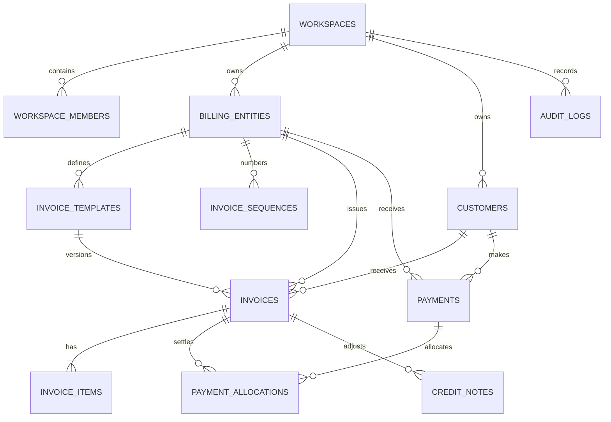
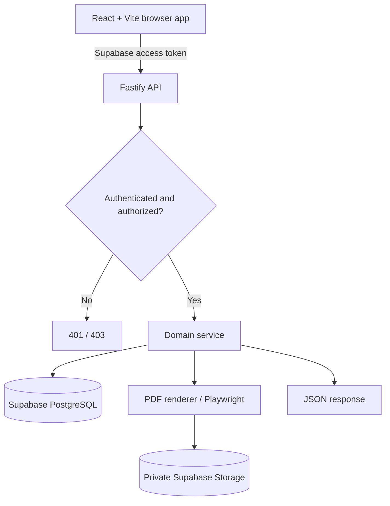

# Project Scope — Dual-Entity Billing & Financial Analytics System

> **Document type:** Product Requirements Document (PRD) + Technical Scope + Implementation Blueprint  
> **Version:** 1.0  
> **Prepared:** 06 November 2026  
> **Status:** Development-ready planning baseline  
> **Target:** Private, web-based billing application for one owner managing two independently operating companies

---

## 1. Executive Summary

Build a private web application where one authenticated owner can create and manage invoices for **two separate billing entities (companies)**. Each company has its own identity, banking and tax settings, invoice number sequence, PDF invoice template, customers' billing history, invoices, collections, and outstanding balances. A shared workspace lets the owner switch between companies or view **consolidated financial analytics**.

The product focuses on three high-value jobs:

1. **Issue professional invoices quickly**, using the correct company identity and branded template.
2. **Track invoice collections and unpaid balances accurately**, including partial payments and overdue invoices.
3. **Understand billing patterns**, including monthly trends, total billed amounts, entity contribution, and the companies/customers billed by each entity.

The system is **not** intended initially to be a full general-ledger accounting, inventory, payroll, tax-filing, or bank-reconciliation platform.

### 1.1 Agreed technology stack

| Layer | Selected technology | Role |
| --- | --- | --- |
| Frontend | **React + Vite + TypeScript** | Browser-based application |
| Component system | **shadcn/ui** | Tables, dialogs, forms, menus, layout primitives |
| Styling | **Tailwind CSS** | Responsive UI and visual design |
| Routing | React Router | Client-side routes and protected pages |
| Server data | TanStack Query | API queries, mutations, caching, invalidation |
| Forms | React Hook Form + Zod | Form management and validation |
| Charts | Recharts | KPI trends and interactive billing charts |
| Data tables | TanStack Table | Filterable, paginated invoice/customer lists |
| Backend | **Node.js + Fastify + TypeScript** | Secure REST API and business rules |
| DB | **Supabase PostgreSQL** | Relational data and transactional persistence |
| Authentication | Supabase Auth | Private login and session management |
| File storage | Supabase Storage | Private logos, signatures, generated invoice PDFs |
| PDF generation | Playwright (server-side) | Pixel-consistent printable PDFs |
| Date utilities | date-fns | Date calculations and reporting periods |
| Money arithmetic | PostgreSQL `NUMERIC` + `decimal.js` | Precise calculations; avoid JS float-based money |
| Testing | Vitest + Playwright | Unit, integration and end-to-end tests |
| Workspace tooling | pnpm workspaces | Shared types/schemas, web app and API |

**Deployment target:** Static hosting for React, Node-capable hosting/container for Fastify and managed Supabase for data/auth/storage. Hosting vendor decisions are deferred to deployment; confirm current service limits and Playwright runtime support then.

---

## 2. Goals, Boundaries and Success Criteria

### 2.1 Product goals

- Support **two active legal/business entities** from one account; database design must allow additional entities later.
- Provide **separate entity-specific invoice branding and templates**.
- Enable invoice drafts, previews, safe issuance, fixed invoice numbers, PDF generation and downloads.
- Maintain a **shared customer directory** and entity-scoped billing and payment records.
- Provide manual recording of one or multiple payments against invoices.
- Show gross billing, net billing where applicable, collections, outstanding and overdue amounts.
- Show which customers each entity bills, with invoice counts, totals, billing frequency and trends.
- Provide entity-specific and cross-entity reporting with date/customer filters.
- Ensure financial totals reconcile and issued invoices retain immutable historical snapshots.
- Keep the daily workflow simple for a single owner and usable on desktop and mobile browsers.

### 2.2 Scope exclusions for initial release

Not part of the core MVP:

- General ledger, chart of accounts, expense bookkeeping or financial statements.
- Inventory, purchase orders, payroll, HR or inventory valuation.
- Automatic GST return filing, government invoice submission/e-invoicing integration or tax advice.
- Automatic bank feed connections, bank reconciliation or payment gateway settlement.
- Email automation, recurring invoicing or automated reminders.
- Multi-user teams, granular roles, public customer portals or customer login.
- Advanced drag-and-drop template builder.
- Native mobile applications.
- Automated revenue forecasts or AI predictions.

These may be considered in future phases; **do not treat them as delivered or committed MVP requirements**.

### 2.3 Launch success criteria

The MVP is ready when all of the following are true:

- Owner can log in and configure both companies independently.
- Owner can create and issue an invoice for either company with the correct template and sequence.
- Issued invoice PDF and original financial details remain stable after company/customer profile edits.
- Owner can record partial/full payments, and remaining balances and overdue labels update correctly.
- Entity A and Entity B data never mix in invoices, numbering, payments or entity-level reports.
- Combined reports equal the sum of their component entities for the same definitions and filters.
- User can inspect **customer-wise billed amounts and trends** for each company.
- A full critical-path test suite passes and backup/restore procedures are documented.

---

## 3. Users and Access Model

### 3.1 Primary user

**Workspace owner** (only required user in V1): administers company profiles; creates/edits invoices; issues or voids invoices; records payments; checks dashboards; downloads reports.

### 3.2 Access rules

- One workspace is owned by one authenticated Supabase user in the MVP.
- All billing entities belong to the workspace.
- An entity switch changes the active UI context and default entity for new invoices.
- **Every backend action must independently verify workspace ownership/membership**; a client-supplied entity ID is never authorization.
- `All entities` is an **analytics/read-only filter**, not a valid seller for a new invoice.
- Data model includes a `workspace_members` table for future expansion, but only the `owner` role needs full implementation initially.

### 3.3 Entity separation policy

Separate **business data and reporting**, not infrastructure:

| Item | Scope |
| --- | --- |
| Login and application | Shared |
| Supabase project/database | Shared, securely partitioned by workspace/entity IDs |
| Customer master list | Workspace-shared |
| Seller/legal details, logo, bank details, taxes | Entity-specific |
| Invoice template and numbering | Entity-specific |
| Invoice, payment, credit adjustments | Entity-specific |
| Customer's invoice history | Derived per entity; combined view optional |
| Dashboard | Entity-specific or combined |

---

## 4. Domain Model and Business Rules

### 4.1 Core concepts

- **Workspace:** root container for the owner's data.
- **Billing entity:** a company that sends invoices, with legal/tax/bank/profile fields.
- **Customer:** a business receiving the invoice; shared across entities.
- **Invoice:** legally significant issued document belonging to one entity and one customer.
- **Invoice item:** service/product line with rate, quantity, discount and tax details.
- **Template:** versioned display configuration belonging to one entity.
- **Payment:** money received by one entity from one customer.
- **Payment allocation:** payment amount applied to one invoice. Allows partial payments and multiple payments per invoice.
- **Credit note:** post-issue financial adjustment; full workflow deferred to V2 unless required by legal use case.
- **Audit event:** record of sensitive mutations with actor, timestamp and before/after metadata.

### 4.2 Invoice lifecycle and payment state

Keep lifecycle separate from collection progress:

**Invoice lifecycle:** `draft` → `issued` → `void` (only through a controlled void operation). Do not hard-delete issued invoices.

**Payment state (derived):**

- `unpaid`: allocated payments = 0 and payable balance > 0.
- `partially_paid`: allocated payments > 0 and payable balance > 0.
- `paid`: remaining payable balance = 0.

**Overdue:** a derived flag when `due_date < reporting_date` and outstanding balance > 0 on a non-void issued invoice. `Overdue` is **not** a fourth invoice lifecycle status and should not overwrite the payment state.

### 4.3 Monetary rules

- Currency **INR** for V1; display with `₹` and Indian digit grouping in UI; persist currency code on records for future extensibility.
- Store amounts using `NUMERIC(18,2)` or suitable precision; quantities/rates/tax rates may need higher intermediate precision.
- Perform all final financial computations on the backend with explicit rounding policy; don't trust totals sent by the browser.
- Define discount treatment (line or invoice level), taxable base, tax components and round-off explicitly.
- Use database transactions for invoice issuance, sequence assignment and payment allocation.
- Never silently edit the totals of an issued invoice. Use a controlled void/correction process; add partial credit notes as a formal V2 capability.
- Do not permit payment allocation beyond either the source payment's unallocated balance or the target invoice's remaining amount.
- Keep entity and customer of a payment consistent with those of its allocated invoice(s).
- Payment reversals/corrections must preserve audit history; never delete paid records silently.

### 4.4 Invoice numbering

Assign a number **only at issuance**, not draft creation. Per entity and financial year, for example:

- Entity A: `ENT-A/26-27/0001`
- Entity B: `ENT-B/26-27/0001`

Numbering format/prefix is configurable per entity; invoice numbers are unique under the defined entity/fiscal-year sequence. A transactional database sequence or locked counter prevents duplicates under concurrent requests. Issued numbers are not recycled, even if an invoice is voided. Define fiscal year using a configurable month (typically April–March for Indian businesses).

### 4.5 Historical immutability

On issue, persist immutable snapshots of:

- Seller business name, address, tax identifiers, contact and bank/payment details.
- Customer billing name, address, tax identifiers.
- Invoice line items, taxes, totals, currency and terms.
- Template version and serialized display configuration.
- Issued timestamp and allocated invoice number.

Changing the customer/entity master record or default template later does **not** silently change previously issued documents. Regeneration should reproduce the stored issued version.

---

## 5. Functional Requirements by Module

### 5.1 M01 — Authentication & Workspace

**Requirements**

- Email/password or magic-link sign-in using Supabase Auth.
- Private/invitation-only signup; no public self-registration in the MVP.
- Protected pages and automatic session restoration/log-out.
- Create one workspace on account initialization.
- Handle expired sessions and unauthorized API responses safely.

**Acceptance**: Logged-out visitors cannot access billing pages/APIs; one user cannot access another workspace by changing IDs in URLs.

### 5.2 M02 — Entity Management

**Entity fields:** legal name, trade/display name, entity code, billing address, contact phone/email, GST registration state, GSTIN when applicable, PAN if needed, place/state of supply defaults, logo, optional signature, bank name, account number, IFSC, account holder, UPI/payment instructions, invoice prefix, default due days, fiscal year start, status.

**Requirements**

- Create, view and edit Entity A and Entity B.
- Configure separate templates, bank details and invoice numbering.
- Activate one entity in the global header selector.
- Disable/archiving workflow for an entity without deleting historical invoices.
- Show quick overview of invoices, collections and balance for the active entity.

**Acceptance**: Changing Entity A's logo, bank account or template does not change Entity B or old issued invoices.

### 5.3 M03 — Customer Directory

**Customer fields:** legal/business name, display name, billing and optional shipping address, contact name, email, phone, GSTIN (optional), state/country, default due days, notes, active flag, timestamps.

**Requirements**

- Add, edit, search, archive and list customers.
- Prevent unintended duplicate records using soft warnings for similar names/GSTIN; allow legitimate differences.
- Reuse one customer record for invoices issued by both entities.
- Open a customer profile with aggregate and per-entity invoice history, amounts billed, payments and outstanding.
- Filter customer tables by active entity and billing history, not only master-data presence.

**Acceptance**: One customer can be billed by A and B; their separate invoice histories and combined totals are correct.

### 5.4 M04 — Invoice Management

**Invoice creation fields**

- Entity and customer (mandatory).
- Issue date (finalized on issue), due date/payment terms, optional reference/PO number.
- Line items: description, quantity, rate, optional unit, discount, tax code/percentage, computed amounts.
- Optional shipping details, notes, terms, internal memo and payment instructions.
- Amount breakdown: subtotal, discounts, taxable value, taxes, optional adjustment/round-off, grand total.

**Required actions**

- Create/save draft; edit draft; delete draft with confirmation.
- Preview entity template using current draft data.
- Issue: backend validation, atomic numbering, snapshot, immutable finance, queue/generate PDF.
- List with text search, date range, entity, customer, payment status, overdue and amount filters.
- View issued invoice, download PDF, duplicate into a new draft.
- Void an invoice with mandatory reason and audit trail; restrict voiding when payments exist until those allocations are resolved according to documented correction rules.
- Expose PDF generation state (`pending`, `ready`, `failed`) and controlled retry.

**Acceptance**: Two concurrent issue requests cannot duplicate a number, and a PDF failure doesn't issue a duplicate invoice.

### 5.5 M05 — Invoice Template Management

**Requirements**

- Each entity has its own default template.
- Provide at least two design presets: **structured corporate** and **clean minimal**.
- Configurable logo, title, colors, fonts, sections, columns, tax summary, banking information, signature, terms and footer.
- A4 print-ready output and on-screen preview using the same rendering system.
- Version templates when published; previews may use a mutable draft config.
- Preserve the issued invoice's template version/configuration.
- Sanitize user-supplied rich content and escape template interpolations.

**V1 boundary:** A configuration-based editor, **not** a freeform drag-and-drop designer.

**Acceptance**: The two entities can issue visually distinct PDFs and older PDFs remain reproducible.

### 5.6 M06 — Payments & Outstanding

**Payment fields:** entity, customer, receipt date, amount, method (`bank_transfer`, `upi`, `cash`, `cheque`, `other`), transaction/reference number, notes, allocated/unallocated amount.

**Requirements**

- Record a payment and allocate all or part of it to one or more eligible invoices of the **same entity and customer**.
- Allow several payments against one invoice.
- Show remaining balance, paid percentage and due/overdue indicator.
- Search/filter payments by entity, customer, receipt date, method and invoice.
- Correct or reverse payments through explicit audited actions, recalculating allocations.
- Invoice detail view displays payment timeline and receipt references.
- Define a customer-level outstanding view, drilldown by aging bucket and specific invoices.

**Acceptance**: ₹50,000 invoice plus ₹20,000 allocated payments displays ₹30,000 outstanding and `partially_paid`.

### 5.7 M07 — Dashboard & Financial Reporting

**Global controls**

- Entity: `All entities`, `Entity A`, `Entity B`.
- Period: this month, this quarter, this fiscal year, custom date range.
- Optional customer selector and comparison period.

**Top KPIs**

1. Gross billing.
2. Net billing (when adjustments are enabled).
3. Collections received.
4. Total outstanding.
5. Overdue outstanding.
6. Invoice count, average invoice value, collection rate and growth rate.

**Charts and analysis**

- Monthly billed vs collected (dual-series bar/line chart).
- Billing trend (month/quarter/year).
- Entity contribution comparison.
- Top billed customers (total and invoice count).
- Customer billing frequency and recency.
- Outstanding by customer.
- Aging buckets: not yet due, 1–30, 31–60, 61–90, >90 days late.
- Month-on-month growth (with meaningful treatment of zero prior period).
- Optional billed-customer concentration (% from top N customers).

**Critical reporting rule:** `Billing during selected period` uses invoice issue dates, `collections during selected period` uses receipt dates, and `outstanding as of date` is a balance snapshot. Clearly label these different time semantics. A single chart must not imply that collections made in a month necessarily correspond to invoices issued in that month.

**Acceptance**: KPI totals reconcile to underlying records, and entity-specific sums equal combined totals on the same basis.

### 5.8 M08 — Customer Billing Analytics

For each customer provide:

- Invoices count and first/most recent invoice dates.
- Gross/net billed by company and combined.
- Collections and total open balance by company.
- Average invoice size and invoice frequency.
- Monthly billing history chart.
- Trend label (`growing`, `stable`, `declining`, `inactive`) based on a documented configurable comparison method; avoid presenting it as a risk/credit score.
- An invoice drilldown with payment details.

**Acceptance**: Opening one customer's profile reveals whether A, B, or both entities have billed that customer and how the pattern evolved.

### 5.9 M09 — Settings, Export and Audit

**Requirements**

- Account/session settings, timezone (`Asia/Kolkata` default), locale and fiscal year configuration.
- Invoice numbering, payment terms and tax defaults for each entity.
- Export invoice, payment and customer reports to CSV (selected entity/period/filter respected).
- Access archived invoices securely.
- Audit significant events: entity updates, invoice issues/voids, payment creates/reversals, template publishes, export operations.
- Document backup and restore procedures.

**Acceptance**: Audit records explain who changed or issued key financial records; exports reconcile to filtered tables.

---

## 6. Navigation, Screens and UX Scope

### 6.1 Global layout

Use a **desktop-first, responsive application shell**:

- Persistent left sidebar on desktop; collapsible navigation drawer on small screens.
- Top toolbar with workspace title, **entity switcher**, date context and user menu.
- Prominent `New Invoice`, `Add Customer`, `Record Payment` quick actions.
- Content area uses shadcn/ui cards, tables, tabs, dialogs, forms and dropdowns.
- Clean neutral UI, accessible contrast and restrained semantic payment colors.
- Loading skeletons, empty states, validation messages, confirmation dialogs and recoverable errors.

**Sidebar routes**

```text
Overview
Invoices
Customers
Payments
Analytics
Entities
Templates
Settings
```

### 6.2 Screen-by-screen requirements

| Screen | Required components | Primary actions |
| --- | --- | --- |
| Login | Auth form, error state | Sign in, sign out |
| Overview | KPI cards, billing/collection chart, entity comparison, top customers | Change entity/period, drill down |
| Entities | Company cards, edit form, logo upload, tax/bank/sequence settings | Create/configure/switch entity |
| Customers | Filterable table, search, customer form | Add/edit/archive customer |
| Customer detail | KPI overview, monthly billing trend, A/B split, invoice/payment tables | Open invoices, filter by entity |
| Invoice list | Table with number, seller, customer, issue/due date, total, paid, balance, state | New, open, duplicate, filter, export |
| Invoice editor | Itemized form, calculated totals, preview pane | Save draft, preview, issue |
| Invoice detail | Frozen invoice summary, PDF viewer/download, payment timeline, audit events | Download, duplicate, void, record payment |
| Payments | Payments table, allocate payment modal, customer filter | Create, allocate, reverse |
| Analytics | Trend charts, aging, customer rankings, growth, drilldowns | Filter, export |
| Templates | Entity template selector, settings form, live preview | Preview, publish version |
| Settings | User, locale, fiscal year, backups, preferences | Update settings |

### 6.3 Suggested desktop invoice editor wireframe

```text
┌───────────────────────────────────────────────────────────────────┐
│ Sidebar │ Entity: Company A      Invoice Draft         Save  Issue│
├─────────┬────────────────────────────┬────────────────────────────┤
│         │ Customer / Dates           │                            │
│         │ Billing Details            │  Live Invoice Preview      │
│         │ Line Items (+ Add Item)    │  [Company A's template]    │
│         │ Discount / Tax             │                            │
│         │ Notes / Terms              │  A4 document preview       │
│         │ Totals                     │                            │
│         └────────────────────────────┴────────────────────────────┤
└───────────────────────────────────────────────────────────────────┘
```

On mobile: use stacked form sections and a separate `Preview` tab/modal rather than squeezing the two desktop columns side by side.

### 6.4 Visual rules

- Typography: Inter or comparable legible sans-serif.
- Consistent spacing, icons and high information density without clutter.
- Status markers: distinct `Draft`, `Issued`, `Void`, `Unpaid`, `Partially Paid`, `Paid` and `Overdue` (lifecycle vs payment labels displayed separately).
- Neutral main workspace design; entity-specific colors may appear in switcher and invoice previews.
- Always format money with currency and thousands grouping; right-align numeric table cells.
- Tables: sorting, pagination, empty/no-results states, and retained filters where practical.
- Confirm destructive actions and explain irreversibility of issuance/voiding.
- Accessible keyboard controls and readable print/PDF output.

---

## 7. Analytics Definitions and Calculation Contract

Precise definitions prevent a dashboard from displaying conflicting numbers.

| Metric | Definition | Time basis |
| --- | --- | --- |
| Gross billing | Sum of grand totals of issued, non-void invoices **including tax**, before credit adjustments | Invoice issue date within selected range |
| Net billing | Gross billing less eligible credit notes/adjustments attributed under defined report policy | Clearly documented issue/adjustment date policy |
| Collections | Sum of confirmed payments received, net of reversals/refunds, attributed to entity | Actual payment receipt date |
| Invoice count | Count of non-void issued invoices | Issue date |
| Average invoice value | Gross billing / invoice count (where count > 0) | Invoice issue date |
| Current outstanding | Sum of remaining payable invoice balances across open issued invoices | As-of reporting date, regardless of original issue period |
| Overdue outstanding | Subset of outstanding with due date earlier than as-of date | As-of reporting date |
| Collection rate (invoice cohort) | Payments allocated to invoices issued in selected period / net collectible value of those invoices | Specific issuance cohort; state as-of date |
| Billing growth % | `(current billed - previous billed) / previous billed × 100` | Like-for-like periods; if prior = 0, show N/A |
| Customer concentration | Top N customers' gross billing / all customers' gross billing | Selected invoice issue period |

**Do not calculate `collection rate` as current-month cash collections divided by current-month invoices** without explanation: those may refer to different invoice cohorts.

### 7.1 Example invoice balance

- Invoice grand total: **₹50,000**
- Confirmed allocated receipts: **₹20,000**
- Credit adjustments: **₹0**
- Outstanding: **₹30,000**
- Payment state: **Partially paid**
- If due date has elapsed: also show **Overdue**.

### 7.2 Time handling

- Persist audit/event timestamps as UTC timestamps with timezone.
- Store invoice issue/due dates as calendar dates where appropriate.
- Display in `Asia/Kolkata` by default.
- Report by entity-specific configured fiscal year; default April–March.
- Explicitly handle custom date range inclusivity, leap years and month boundaries.

### 7.3 Data refresh strategy

- Use TanStack Query caching with invalidation after issuance, payment entry/reversal, invoice void, or edits affecting reports.
- Backend is the source of truth for sums and aggregates.
- For personal-scale datasets, start with SQL aggregation via views/functions; introduce materialized views or caching only if profiling indicates a need.

---

## 8. Data Model — Supabase PostgreSQL

### 8.1 Logical relationship diagram



### 8.2 Table specification

**`workspaces`**

- `id UUID PK`, `name TEXT`, `owner_user_id UUID` (Supabase Auth user), `created_at TIMESTAMPTZ`, `updated_at TIMESTAMPTZ`.

**`workspace_members`**

- `workspace_id UUID FK`, `user_id UUID`, `role TEXT` (`owner`; other roles reserved), `created_at`.
- Composite unique `(workspace_id, user_id)`.

**`billing_entities`**

- `id UUID PK`, `workspace_id UUID FK`, `entity_code TEXT`, `legal_name TEXT`, `display_name TEXT`, `billing_address JSONB`, `email TEXT`, `phone TEXT`, `gst_registered BOOLEAN`, `gstin TEXT NULL`, `pan TEXT NULL`, `state_code TEXT NULL`, `logo_path TEXT NULL`, `signature_path TEXT NULL`, `bank_details JSONB`, `upi_id TEXT NULL`, `payment_instructions TEXT`, `invoice_prefix TEXT`, `default_due_days INT`, `financial_year_start_month INT`, `settings JSONB`, `is_active BOOLEAN`, `created_at`, `updated_at`.
- Unique `(workspace_id, entity_code)`.

**`customers`**

- `id UUID PK`, `workspace_id UUID FK`, `legal_name TEXT`, `display_name TEXT`, `billing_address JSONB`, `shipping_address JSONB NULL`, `contact_name TEXT`, `email TEXT`, `phone TEXT`, `gstin TEXT NULL`, `state_code TEXT NULL`, `payment_terms_days INT`, `notes TEXT`, `is_active BOOLEAN`, `created_at`, `updated_at`.

**`invoice_templates`**

- `id UUID PK`, `entity_id UUID FK`, `name TEXT`, `version INT`, `preset TEXT`, `config_json JSONB`, `is_default BOOLEAN`, `is_published BOOLEAN`, `published_at TIMESTAMPTZ NULL`, `created_at`.
- Unique `(entity_id, name, version)`; enforce at most one active default per entity.

**`invoice_sequences`**

- `entity_id UUID FK`, `financial_year TEXT`, `document_type TEXT` (`invoice`, later `credit_note`), `next_number BIGINT`, `updated_at`.
- Composite primary/unique `(entity_id, financial_year, document_type)`.

**`invoices`**

- `id UUID PK`, `workspace_id UUID FK`, `entity_id UUID FK`, `customer_id UUID FK`, `template_id UUID FK NULL`, `invoice_number TEXT NULL`, `financial_year TEXT NULL`, `lifecycle_status TEXT`, `issue_date DATE NULL`, `due_date DATE`, `currency CHAR(3)`, `reference_number TEXT NULL`, `subtotal NUMERIC(18,2)`, `discount_total NUMERIC(18,2)`, `taxable_total NUMERIC(18,2)`, `tax_total NUMERIC(18,2)`, `round_off NUMERIC(18,2)`, `grand_total NUMERIC(18,2)`, `notes TEXT`, `terms TEXT`, `seller_snapshot JSONB NULL`, `customer_snapshot JSONB NULL`, `template_snapshot JSONB NULL`, `pdf_path TEXT NULL`, `pdf_status TEXT`, `issued_at TIMESTAMPTZ NULL`, `voided_at TIMESTAMPTZ NULL`, `void_reason TEXT NULL`, `created_at`, `updated_at`.
- Unique non-null `(entity_id, financial_year, invoice_number)`; check positive totals/valid status.
- Do not persist derived `outstanding` as an independently editable amount.

**`invoice_items`**

- `id UUID PK`, `invoice_id UUID FK`, `sort_order INT`, `description TEXT`, `quantity NUMERIC(18,4)`, `unit TEXT NULL`, `unit_price NUMERIC(18,4)`, `discount_type TEXT NULL`, `discount_value NUMERIC(18,4)`, `tax_code TEXT NULL`, `tax_rate NUMERIC(9,4)`, `taxable_value NUMERIC(18,2)`, `tax_amount NUMERIC(18,2)`, `line_total NUMERIC(18,2)`.
- If Indian GST tax breakup is required, add explicit component rates/amounts or a normalized item-tax table to preserve CGST/SGST/IGST rather than storing only one ambiguous rate.

**`payments`**

- `id UUID PK`, `workspace_id UUID FK`, `entity_id UUID FK`, `customer_id UUID FK`, `amount NUMERIC(18,2)`, `currency CHAR(3)`, `paid_at DATE`, `method TEXT`, `reference_number TEXT NULL`, `notes TEXT`, `status TEXT` (`confirmed`, `reversed`), `reversed_at TIMESTAMPTZ NULL`, `created_at`, `updated_at`.

**`payment_allocations`**

- `id UUID PK`, `payment_id UUID FK`, `invoice_id UUID FK`, `allocated_amount NUMERIC(18,2)`, `created_at`.
- Enforce same entity/customer and available balances **transactionally**, not only at UI level.

**`credit_notes`** (schema-ready; workflow V2 unless legal correction needs it earlier)

- `id UUID PK`, `workspace_id UUID FK`, `entity_id UUID FK`, `invoice_id UUID FK`, `credit_note_number TEXT`, `issued_at TIMESTAMPTZ`, `amount NUMERIC(18,2)`, `reason TEXT`, `status TEXT`, `snapshot JSONB`, `pdf_path TEXT NULL`.

**`audit_logs`**

- `id UUID PK`, `workspace_id UUID FK`, `entity_id UUID NULL`, `actor_user_id UUID`, `resource_type TEXT`, `resource_id UUID`, `action TEXT`, `before_json JSONB NULL`, `after_json JSONB NULL`, `created_at TIMESTAMPTZ`.
- Avoid storing secrets or payment credentials in audit payloads.

### 8.3 Critical integrity constraints

1. Invoice, payment and template entity IDs must refer to entities in the same workspace.
2. Invoice customer IDs must belong to the same workspace as the entity.
3. Payment allocation invoice must have **same entity and same customer** as the payment.
4. Payment allocation amounts must be positive and sum to no more than payment amount.
5. Invoice allocations must not exceed net collectible amount.
6. Invoice numbering is assigned atomically within an issuance transaction and never reused.
7. Issued invoices may not have their historical money fields/snapshots changed through ordinary update endpoints.
8. Sensitive deletes become archive/void/reverse operations, not direct destructive deletes.
9. Keep DB constraints in addition to API validation; use transaction locks where aggregate constraints cannot be guaranteed by a simple check constraint.

### 8.4 Index plan

Add indices after migration creation for frequent query patterns:

- `invoices(entity_id, issue_date DESC)`
- `invoices(entity_id, due_date)`
- `invoices(customer_id, issue_date DESC)`
- `invoices(workspace_id, lifecycle_status, issue_date DESC)`
- `payments(entity_id, paid_at DESC)`
- `payment_allocations(invoice_id)`, `payment_allocations(payment_id)`
- `customers(workspace_id, legal_name)` plus search strategy (normalized name/trigram as needed)
- Uniqueness constraints for entity code and invoice numbering.

---

## 9. Backend Design and REST API Scope

### 9.1 Request flow



**Design rules**

- Fastify handles invoice issuance, calculations, payments, reporting and PDF workflows.
- React **never** submits trusted financial totals or writes issued invoices directly.
- Use Supabase Auth JWT verification and workspace/entity authorization in all relevant API handlers.
- For ordinary DB operations, prefer user-scoped access with RLS; for server-only privileged tasks, use carefully constrained server operations/transactional database functions with explicit authorization.
- Keep Supabase `service_role` key on server only, never in browser bundles or logs.
- Validate requests and responses with shared Zod schemas and documented error codes.
- Paginate list endpoints; enforce reasonable size limits and sort allowlists.
- Log request IDs; avoid logging full personal/tax/bank details.
- Treat `entityId=all` as an analytics filter only.

### 9.2 API endpoints

Base path: `/api/v1`.

| Method | Endpoint | Responsibility |
| --- | --- | --- |
| GET | `/me` | Current user and workspace profile |
| GET | `/entities` | List accessible entities |
| POST | `/entities` | Create entity |
| GET | `/entities/:entityId` | Get entity details |
| PATCH | `/entities/:entityId` | Update settings |
| GET | `/customers` | Search/filter/paginate customers |
| POST | `/customers` | Add customer |
| GET | `/customers/:customerId` | Customer master details |
| PATCH | `/customers/:customerId` | Edit customer |
| GET | `/customers/:customerId/summary` | Customer billing stats and invoice trends |
| GET | `/invoices` | Filterable invoice list |
| POST | `/invoices` | Create draft invoice |
| GET | `/invoices/:invoiceId` | Get invoice detail |
| PATCH | `/invoices/:invoiceId` | Edit draft |
| DELETE | `/invoices/:invoiceId` | Delete draft only |
| POST | `/invoices/:invoiceId/issue` | Atomic issue and sequence assignment |
| POST | `/invoices/:invoiceId/void` | Controlled void with reason |
| POST | `/invoices/:invoiceId/duplicate` | Create a new draft from existing |
| GET | `/invoices/:invoiceId/pdf` | Authenticated PDF retrieval/signed URL |
| POST | `/invoices/:invoiceId/pdf/retry` | Retry failed PDF job idempotently |
| GET | `/payments` | List payments |
| POST | `/payments` | Create payment and optional allocations |
| POST | `/payments/:paymentId/allocate` | Allocate remaining funds to invoices |
| POST | `/payments/:paymentId/reverse` | Audited reversal |
| GET | `/templates` | List templates by entity |
| POST | `/templates` | Create template draft/configuration |
| PATCH | `/templates/:templateId` | Update unpublished template |
| POST | `/templates/:templateId/publish` | Publish immutable version |
| POST | `/templates/preview` | Safe server-rendered sample preview |
| GET | `/dashboard/overview` | KPI values for selected filters |
| GET | `/analytics/billing-trends` | Monthly/quarterly billed vs collected |
| GET | `/analytics/entity-comparison` | Entity contribution |
| GET | `/analytics/customers` | Customer ranking/trends |
| GET | `/analytics/outstanding-aging` | Due date aging buckets |
| GET | `/reports/export` | Authorized CSV report export |
| GET | `/audit-logs` | Workspace audit trail |

All mutation endpoints require proper authentication; crucial creation/issue/allocation endpoints should support idempotency keys to prevent duplicate processing when requests are retried.

### 9.3 Common query parameters

```text
entityId=<uuid> | all      # all only where explicitly permitted
from=YYYY-MM-DD
to=YYYY-MM-DD
customerId=<uuid>
status=draft|issued|void
paymentStatus=unpaid|partially_paid|paid
isOverdue=true|false
page=1
pageSize=25
sort=issue_date:desc
```

### 9.4 Example draft-create payload

```json
{
  "entityId": "<entity-uuid>",
  "customerId": "<customer-uuid>",
  "dueDate": "2026-11-30",
  "currency": "INR",
  "items": [
    {
      "description": "Website maintenance services",
      "quantity": "1.0000",
      "unitPrice": "25000.0000",
      "discountValue": "0",
      "taxRate": "0"
    }
  ],
  "notes": "Thank you for your business"
}
```

The server responds with **calculated authoritative totals**, current draft ID and validation errors as appropriate. Issuance is a separate endpoint.

### 9.5 Standard error model

```json
{
  "error": {
    "code": "INVOICE_ALREADY_ISSUED",
    "message": "This invoice has already been issued.",
    "requestId": "<request-id>"
  }
}
```

Use consistent HTTP semantics (`400` invalid input, `401` missing/expired auth, `403` forbidden, `404` not found, `409` conflict, `422` domain validation).

---

## 10. PDF Generation and Template Versioning

### 10.1 Reliable issue-to-PDF flow

1. User confirms the draft and correct billing entity.
2. Backend verifies access, draft state, customer, taxes and totals.
3. In one DB transaction, allocate next sequence, stamp invoice number, issue date, snapshots and `issued` state.
4. Commit the transaction; return invoice ID and `pdfStatus=pending`.
5. Render the snapshot through the selected trusted HTML/CSS template.
6. Use Playwright to print A4 PDF with correct margins, page breaks and font handling.
7. Upload PDF to **private** Supabase Storage path scoped by workspace/entity/invoice.
8. Save `pdf_path`, set `pdf_status=ready`, expose download behind authorization.
9. On rendering/storage failure, set `pdf_status=failed` and allow a safe retry **without reissuing or renumbering**.

For the MVP, PDF processing can run in a carefully managed backend task/queue; if an external queue service is not yet deployed, create a durable `pdf_jobs` database table or equivalent retry mechanism so a process restart does not lose PDF work. Avoid treating a detached in-memory promise as a reliable job queue.

### 10.2 Example template design directions

| Entity | Suggested starting preset | Visual treatment |
| --- | --- | --- |
| Entity A | Corporate / structured | Strong colored header, organized tax table, compact totals |
| Entity B | Minimal / contemporary | Spacious layout, restrained accent, clear amount due callout |

These are starting presets, not mandatory brand identities. Each entity can use its own logo and configurable colors.

### 10.3 PDF QA

- A4 output, multi-page line item tables, repeated headers, footer, no clipped amounts.
- Test long legal addresses, long descriptions, zero/non-zero tax, large totals.
- Confirm PDF snapshot matches API-calculated amounts.
- Verify uploaded PDF can only be retrieved by an authorized user.
- Review print rendering on relevant Chromium/Playwright deployment runtime.

---

## 11. Security, Compliance and Data Protection

### 11.1 Security baseline

- Supabase Auth, private signup and token verification.
- Row Level Security (RLS) on workspace-owned tables.
- API-level workspace/entity ownership checks before all business operations.
- Never expose Supabase privileged secrets or private bucket URLs publicly.
- Signed URLs for PDF downloads with short expiry, or stream bytes through authenticated endpoint.
- Input validation, HTML escaping, reasonable request limits and security headers.
- CSRF considerations if using cookies; use appropriate token strategy and CORS allowlist.
- Account/session logout and token expiry management.
- Append-only or tightly protected financial audit events.
- Secrets via environment variables/secret manager, not Git.
- DB backups and periodically tested restoration.

### 11.2 India/GST readiness

- Each entity independently indicates whether GST is applicable.
- Support supplier/customer GSTIN, applicable HSN/SAC, place of supply, and distinct CGST/SGST/IGST where required.
- Invoice format and series should be configurable to match real business obligations.
- Consider tax invoice vs bill of supply and other document types based on the actual company status.
- **Do not claim GST compliance or e-invoicing support solely from having tax fields.** Actual compliance, document wording, tax calculation and applicable rules require review for the particular businesses and their obligations before live tax invoice use.
- Invoice PDF should include all relevant required fields for the invoice type in use.

### 11.3 Data retention and correction

- Keep issued invoice records and files; don't physically delete them through UI.
- Allow drafts to be deleted; archive customers/entities without destroying historical references.
- Use explicit reversal/void actions with audit trail; post-issue partial adjustment support is V2.
- Define operational handling if an issued document must be legally adjusted: use a credit-note workflow before relying on this system for cases requiring one.

---

## 12. Codebase and Repository Structure

```text
billing-workspace/
├── apps/
│   ├── web/                           # React + Vite + TypeScript
│   │   ├── src/
│   │   │   ├── app/
│   │   │   │   ├── router.tsx
│   │   │   │   └── providers.tsx
│   │   │   ├── components/
│   │   │   │   ├── ui/                # shadcn/ui source components
│   │   │   │   ├── layout/
│   │   │   │   ├── charts/
│   │   │   │   └── shared/
│   │   │   ├── features/
│   │   │   │   ├── auth/
│   │   │   │   ├── dashboard/
│   │   │   │   ├── entities/
│   │   │   │   ├── customers/
│   │   │   │   ├── invoices/
│   │   │   │   ├── payments/
│   │   │   │   ├── analytics/
│   │   │   │   └── templates/
│   │   │   ├── hooks/
│   │   │   ├── lib/                   # API client, auth, formatters
│   │   │   ├── styles/
│   │   │   └── main.tsx
│   │   ├── index.html
│   │   └── package.json
│   └── api/                           # Fastify Node.js TypeScript
│       ├── src/
│       │   ├── app.ts
│       │   ├── server.ts
│       │   ├── plugins/
│       │   ├── middleware/
│       │   ├── modules/
│       │   │   ├── entities/
│       │   │   ├── customers/
│       │   │   ├── invoices/
│       │   │   ├── payments/
│       │   │   ├── analytics/
│       │   │   └── templates/
│       │   ├── services/
│       │   │   ├── pdf/
│       │   │   ├── storage/
│       │   │   └── tax/
│       │   └── utils/
│       └── package.json
├── packages/
│   └── shared/                        # Shared TS types, Zod contracts
├── supabase/
│   ├── migrations/
│   ├── seeds/
│   └── tests/                         # RLS/integrity tests
├── tests/
│   └── e2e/                           # Browser journeys
├── docs/
├── .env.example
├── package.json
├── pnpm-workspace.yaml
└── README.md
```

### 12.1 Module code conventions

Inside each backend module, prefer:

```text
invoices/
├── invoice.routes.ts
├── invoice.controller.ts
├── invoice.service.ts
├── invoice.repository.ts
├── invoice.schema.ts
└── invoice.test.ts
```

Keep route/controller concerns separate from core business service logic. Reuse shared Zod contracts between frontend and backend where safe.

### 12.2 Environment configuration checklist

```dotenv
# Web (only public, browser-safe values)
VITE_API_URL=http://localhost:3001/api/v1
VITE_SUPABASE_URL=...
VITE_SUPABASE_ANON_KEY=...

# API (server only)
PORT=3001
SUPABASE_URL=...
SUPABASE_SERVICE_ROLE_KEY=...  # server-only; privileged usage tightly controlled
DATABASE_URL=...              # if direct DB transaction access is used
APP_ORIGIN=http://localhost:5173
LOG_LEVEL=info
```

Do not commit `.env` files. Document exactly which credentials are browser-safe and which are secret. Use separate dev and production Supabase projects when possible.

---

## 13. Implementation Plan and Dependencies

### Phase 1 — Foundation

- Create pnpm monorepo with `apps/web`, `apps/api`, `packages/shared`.
- Initialize React/Vite, Tailwind, shadcn/ui, TypeScript, React Router and TanStack Query.
- Initialize Fastify, app-wide error handling, auth middleware and request validation.
- Create Supabase project, migrations, RLS policy skeleton and private storage buckets.
- Add protected routes, sign-in and base sidebar/topbar.
- Add CI scripts for typecheck, lint, tests and build.

**Exit condition:** owner can securely sign in; web calls authenticated API; baseline policies and migrations work.

### Phase 2 — Entities and customers

- Implement workspace, member, entity and customer tables.
- Build entity onboarding/settings, company selector and shared customer CRUD.
- Add strict authorization and ownership/integrity checks.
- Create seed data for two sample entities and customers in development only.

**Exit condition:** two companies can be configured independently, sharing customer directory safely.

### Phase 3 — Invoice engine and PDF

- Implement draft editor and line-item calculations.
- Add entity-specific invoice sequences with transactional issuance.
- Freeze invoice snapshots; build two template presets and configurable defaults.
- Generate/secure PDFs; add retryable PDF generation status.
- Implement invoice lists, details, preview, duplicate, draft delete and controlled void.

**Exit condition:** end-to-end creation and PDF download for both companies.

### Phase 4 — Payment tracking

- Implement payment and allocation data model with transaction safety.
- Add manual payment creation, partial/full allocation and audited reversals.
- Derive payment state and overdue labels; show aging and invoice payment timeline.

**Exit condition:** outstanding balances reconcile for single and multiple partial payments.

### Phase 5 — Dashboard and analytics

- Build backend SQL aggregates and filters.
- Add financial overview KPI cards and billing/collection trend charts.
- Add entity comparison, customer rankings, customer profile trends and aging.
- Add CSV exports and reconcile outputs against underlying records.

**Exit condition:** all required billing, customer and outstanding reporting is available for A/B/combined views.

### Phase 6 — Quality, hardening and deployment

- Unit, integration, RLS, API, E2E and PDF snapshot QA.
- Verify duplicate issue requests, race conditions, rounding and financial year changes.
- Establish backup, restore, secret and observability procedures.
- Deploy frontend, API and Supabase; test production auth/CORS, PDF and signed downloads.

**Exit condition:** release checklist in Section 15 passes.

### 13.1 Dependency order

```text
Auth / workspace
       ↓
Entities + shared customers
       ↓
Invoice draft + calculations
       ↓
Atomic issuance + template + PDF
       ↓
Payments + allocations
       ↓
Reporting + customer analytics
       ↓
Security/performance validation + production launch
```

Build dashboards **after** trustworthy financial records and payment allocation logic exist so charts do not need to be redesigned around incorrect assumptions.

---

## 14. MVP vs Future Releases

| Capability | V1 MVP | V2 / Later |
| --- | --- | --- |
| Two billing entities | Required | Add more entities |
| Independent company identity | Required | Additional branding fields |
| Separate invoice numbering | Required | Per-document configurable numbering |
| Shared customer master | Required | Duplicate detection/import improvements |
| Draft, issued, void invoices | Required | Deeper document workflows |
| Configurable template presets | Required | Drag-and-drop builder |
| Server-generated PDFs | Required | Email send/archive workflows |
| Manual payments & partial allocation | Required | Payment gateway/bank import |
| Customer invoice history | Required | CRM integrations |
| Gross billing & collections analytics | Required | Cash-flow prediction |
| Outstanding and overdue tracking | Required | Automated reminders |
| CSV and PDF exports | Required | More report formats |
| Owner authentication | Required | Team roles and permissions |
| Tax-related fields | Baseline, with reviewed live usage | E-invoice/filing integrations |
| Credit note full workflow | Defer unless essential for safe real-world correction | Formal credit-note workflow |
| Recurring invoices | Not included | Optional |
| Automatic email reminders | Not included | Optional |

---

## 15. Test Scenarios and Release Acceptance Checklist

### 15.1 Billing integrity

- [ ] Entity A invoices use A seller profile/template/sequence and never B's.
- [ ] Entity B invoices use B seller profile/template/sequence and never A's.
- [ ] A shared customer can be billed by both entities.
- [ ] Concurrent issue requests never allocate the same invoice number.
- [ ] Duplicate/retried issue requests are idempotent.
- [ ] Draft line-item, discount and tax totals match backend values.
- [ ] Issued seller/customer/financial/template snapshots remain immutable.
- [ ] Failed PDF render can retry without changing invoice identity/number.
- [ ] Invoice long content and multipage PDF layout render correctly.
- [ ] Issued invoices cannot be deleted through user/API routes.

### 15.2 Payment integrity

- [ ] Partial payment calculation produces correct open balance.
- [ ] Several payments on one invoice sum correctly.
- [ ] One payment can allocate across multiple same-entity/customer invoices.
- [ ] Allocations across different entities or customers are rejected.
- [ ] Allocation beyond paid amount or invoice balance is rejected.
- [ ] Reversal updates derived outstanding and retains audit trace.
- [ ] Due-date aging updates correctly at midnight in reporting timezone.

### 15.3 Analytics reconciliation

- [ ] A + B gross billing equals combined gross billing for same period.
- [ ] A + B collections equal combined collections for same period.
- [ ] A + B outstanding equals combined outstanding as of same date.
- [ ] Customer billed totals match drill-down invoice lists.
- [ ] Voided invoices are excluded from revenue KPIs as defined.
- [ ] Date filters handle quarter/fiscal-year boundaries and empty periods.
- [ ] CSV exports reproduce filtered data accurately.
- [ ] Period billing and as-of outstanding are clearly distinguished.

### 15.4 Security and operations

- [ ] Unauthenticated requests are blocked.
- [ ] Workspace/entity ID tampering does not bypass RLS/API authorization.
- [ ] Private PDF files cannot be downloaded anonymously.
- [ ] Server secrets never appear in Vite bundle or browser response.
- [ ] Audit logs capture invoice issue, void and payment reversal.
- [ ] Errors are logged with request IDs without leaking secrets.
- [ ] DB backup is enabled and a restore drill is performed.
- [ ] Mobile layouts, accessibility and error states are reviewed.
- [ ] Actual company tax invoice format is reviewed before real invoicing.

---

## 16. Risks and Mitigations

| Risk | Impact | Mitigation |
| --- | --- | --- |
| Financial rounding discrepancies | Incorrect invoice totals | Decimal-based arithmetic, explicit rounding rules and regression tests |
| Duplicate invoice numbers | Audit/legal confusion | Transactional counter with locks/constraints and idempotency |
| Cross-entity record leakage | Serious privacy/data integrity issue | RLS, workspace checks, cross-entity FK/transaction validation and security tests |
| Lost PDF jobs | Invoices issued without document | Durable job state, retry endpoint, monitoring |
| Historical document mutation | Inconsistent records | Immutable snapshots and template versioning |
| Incorrect dashboard logic | Misleading business decisions | Defined KPI contract and reconciliation tests |
| Invalid GST document format | Real-world compliance problems | Configurable tax fields and professional verification before live use |
| Browser-only validation | Tampered money values | Backend recomputation and DB integrity constraints |
| Backup/hosting limitations | Data loss or downtime | Separate backups, restore drills, verify service quotas |
| Expanding scope too early | Delayed MVP delivery | Phase gates and strict V1 vs V2 distinction |

---

## 17. Open Decisions to Lock Before Coding

These do **not** block initial architecture but should be confirmed before invoice/tax workflows are finalized:

1. Actual registered/legal details of the two businesses, including whether each is GST-registered.
2. Exact required invoice types (standard invoice, GST tax invoice, bill of supply, pro forma, etc.).
3. Invoice numbering prefix and fiscal-year convention for each company.
4. Whether tax rates are fixed defaults or selectable per line item; applicable place-of-supply logic.
5. Required customer fields and any special bank/payment instructions.
6. The two final invoice designs, logos and visual brand styles.
7. Whether there are existing invoices to migrate/import and whether prior numbering must continue.
8. Whether credit notes are needed at initial launch for legally correct handling of reductions/refunds.
9. The deployment host and budget, including reliable Playwright support and backup policy.
10. Whether a single owner remains the only user for the foreseeable future.

Until these are clarified, build with **configurable entity settings** and avoid hardcoding legal/tax assumptions.

---

## 18. Final Build Recommendation

Keep the MVP centered on a dependable workflow:

**Select entity → Select customer → Create invoice → Preview and issue → Download PDF → Record payments → Monitor outstanding → Analyze billing patterns.**

The combination of React/Vite, shadcn/ui, Tailwind, Fastify, and Supabase is sufficient for a maintainable private billing product. Use **one database with logical entity separation**, **server-owned financial operations**, **immutable issued invoices**, and **clear reporting definitions**. Build the actual accounting/billing truth first and the attractive analytics dashboard on top of it—not the other way around.

> **Definition of done:** Two distinct companies can reliably invoice the same or different customers, issue distinct branded PDF bills, track receipts and unpaid balances, and show trustworthy combined and entity-level financial/customer analytics from a single private web application.
